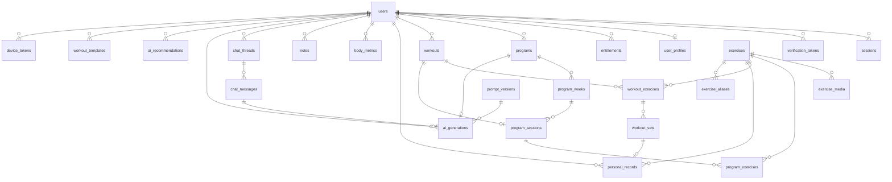

# Data Model — GymApps v1

Dokumen ini adalah sumber kebenaran untuk skema database. PRD: [`PRD.md`](./PRD.md) · API: [`api/openapi.yaml`](./api/openapi.yaml)

**Database:** PostgreSQL 16 · **ORM:** Prisma 6 · **Lokasi file:** `packages/db/prisma/schema.prisma`

---

## 1. Konvensi

| Konvensi | Aturan |
|---|---|
| PK | `id TEXT PRIMARY KEY` — prefix per tabel + ULID sortable (`usr_01HQ8X...`) |
| Waktu | `TIMESTAMPTZ`, disimpan UTC. `created_at` / `updated_at` diisi otomatis (`@default(now())` / `@updatedAt`) |
| Soft delete | `deleted_at TIMESTAMPTZ NULL` pada entitas yang di-sync ke mobile |
| Satuan | Selalu metric: `*_kg`, `*_km`, `*_cm`, `*_m`. Imperial hanya di layer UI |
| Enum | PostgreSQL native enum (`pgEnum`), prefixed nama tabel agar tidak bentrok |
| Array | PostgreSQL `TEXT[]` untuk daftar sederhana (otot sekunder, equipment) |
| JSON | `JSONB` untuk payload yang bentuknya berubah (context AI, evidence rule, metadata export) |
| Full-text | `TSVECTOR` + GIN index pada `exercises` untuk pencarian |
| Audit | `audit_logs` untuk setiap perubahan destruktif |
| Index | Setiap FK di-index; index komposit untuk query utama (lihat §6) |
| Naming | Singular, `snake_case`; tabel jamak (`users`, `workout_sets`) |

---

## 2. ERD



---

## 3. Tabel Inti

### 3.1 `users` — Identitas & Preferensi

| Kolom | Tipe | Constraint | Keterangan |
|---|---|---|---|
| `id` | TEXT | PK | ULID |
| `email` | CITEXT | UNIQUE, NOT NULL | Identitas login (username) |
| `email_verified_at` | TIMESTAMPTZ | NULL | |
| `password_hash` | TEXT | NOT NULL | Argon2id |
| `display_name` | TEXT | NULL | Diisi user; default dari email lokal |
| `locale` | TEXT | NOT NULL, default `'id'` | `id` \| `en` |
| `unit_system` | TEXT | NOT NULL, default `'metric'` | `metric` \| `imperial` |
| `timezone` | TEXT | NOT NULL, default `'Asia/Jakarta'` | IANA |
| `theme` | TEXT | NOT NULL, default `'system'` | `light` \| `dark` \| `system` |
| `role` | TEXT | NOT NULL, default `'user'` | `user` \| `admin` |
| `status` | TEXT | NOT NULL, default `'active'` | `active` \| `pending_delete` \| `deleted` |
| `onboarding_completed_at` | TIMESTAMPTZ | NULL | |
| `email_opt_in` | BOOLEAN | NOT NULL, default `false` | |
| `last_login_at` | TIMESTAMPTZ | NULL | |
| `deleted_at` | TIMESTAMPTZ | NULL | Soft delete; hard delete setelah 30 hari |

**Index:** `unique(email)`, `idx_users_status`, `idx_users_deleted_at`
**Catatan:** `email` wajib dan unik — satu-satunya identitas login. `password_hash` wajib (tidak ada login tanpa password).

### 3.2 `user_profiles` — Profil Latihan (1:1)

| Kolom | Tipe | Constraint | Keterangan |
|---|---|---|---|
| `user_id` | TEXT | PK, FK → users | |
| `goals` | TEXT[] | NOT NULL, default `{}` | `lose_weight`, `gain_muscle`, `strength`, `endurance`, `general_fitness`, `body_recomposition` (maks 2) |
| `experience_level` | TEXT | NULL | `beginner` \| `intermediate` \| `advanced` |
| `days_per_week` | SMALLINT | NULL, CHECK 1–7 | |
| `session_minutes` | SMALLINT | NULL, CHECK 20–120 | |
| `equipment` | TEXT[] | NOT NULL, default `{}` | Lihat enum equipment |
| `injury_areas` | TEXT[] | NOT NULL, default `{}` | `knee`, `shoulder`, `lower_back`, `elbow`, `wrist`, `hip`, `ankle`, `neck` |
| `injury_notes` | TEXT | NULL | |
| `preferred_split` | TEXT | NULL | `full_body` \| `upper_lower` \| `push_pull_legs` \| `bro_split` \| `custom` |
| `preferred_cardio` | TEXT[] | default `{}` | |
| `height_cm` | NUMERIC(5,1) | NULL | |
| `birth_date` | DATE | NULL | Usia min 16 |
| `sex` | TEXT | NULL | `male` \| `female` \| `other` \| `prefer_not_to_say` |
| `program_style_notes` | TEXT | NULL | |
| `created_at` / `updated_at` | TIMESTAMPTZ | | |

### 3.3 `entitlements` — Plan & Kuota

| Kolom | Tipe | Constraint | Keterangan |
|---|---|---|---|
| `id` | TEXT | PK | |
| `user_id` | TEXT | FK → users | |
| `plan` | TEXT | NOT NULL, default `'free'` | `free` \| `pro` |
| `features` | JSONB | NOT NULL, default `{}` | Feature flag per user, mis. `{"pdf_report": true}` |
| `ai_chat_daily_limit` | INTEGER | default `30` | |
| `ai_generate_daily_limit` | INTEGER | default `5` | |
| `valid_from` | TIMESTAMPTZ | NOT NULL | |
| `valid_until` | TIMESTAMPTZ | NULL | NULL = tak terbatas |
| `source` | TEXT | default `'system'` | `system` \| `payment` \| `admin` \| `promo` |
| `created_at` / `updated_at` | TIMESTAMPTZ | | |

**Index:** `unique(user_id, plan)` pada entri yang sedang berlaku (partial index `WHERE valid_until IS NULL`)

> v1: semua user otomatis `free` dengan kuota beta. Tabel & service tetap ada agar v1.2 tidak perlu retrofit.

### 3.4 `exercises` — Katalog Gerakan

| Kolom | Tipe | Constraint | Keterangan |
|---|---|---|---|
| `id` | TEXT | PK | |
| `slug` | TEXT | UNIQUE | URL-friendly, mis. `bench-press` |
| `name_id` | TEXT | NOT NULL | Nama Bahasa Indonesia |
| `name_en` | TEXT | NOT NULL | Nama English |
| `description_id` | TEXT | NULL | 1–2 kalimat |
| `description_en` | TEXT | NULL | |
| `instructions_id` | TEXT[] | NOT NULL, default `{}` | 2–6 langkah |
| `instructions_en` | TEXT[] | NOT NULL, default `{}` | |
| `primary_muscle` | TEXT | NOT NULL | Lihat enum muscle |
| `secondary_muscles` | TEXT[] | NOT NULL, default `{}` | |
| `equipment` | TEXT[] | NOT NULL, default `{}` | |
| `difficulty` | TEXT | NOT NULL, default `'intermediate'` | `beginner` \| `intermediate` \| `advanced` |
| `movement_pattern` | TEXT | NULL | `squat`, `hinge`, `push`, `pull`, `carry`, `core`, `isolation`, `conditioning` |
| `impact_level` | TEXT | NOT NULL, default `'low'` | `low` \| `medium` \| `high` — untuk filter cedera |
| `contraindicated_areas` | TEXT[] | NOT NULL, default `{}` | Area tubuh yang aggravated, mis. squat → `knee` |
| `is_compound` | BOOLEAN | NOT NULL, default `false` | Dipakai validator volume & estimasi durasi |
| `status` | TEXT | NOT NULL, default `'published'` | `draft` \| `published` \| `archived` |
| `source` | TEXT | NOT NULL, default `'seed'` | `seed` \| `custom` \| `admin` |
| `owner_user_id` | TEXT | NULL, FK → users | NULL = global; terisi = custom milik user |
| `review_notes` | TEXT | NULL | Catatan review admin |
| `search_vector` | TSVECTOR | | Generated: `name_id`, `name_en`, `description`, `aliases` |
| `created_at` / `updated_at` / `deleted_at` | TIMESTAMPTZ | | |

**Index:** `unique(slug)`, `idx_exercises_primary_muscle`, `idx_exercises_equipment` (GIN), `idx_exercises_search` (GIN pada `search_vector`), `idx_exercises_owner`, `idx_exercises_status`
**Constraint:** `CHECK ((source = 'custom' AND owner_user_id IS NOT NULL) OR source <> 'custom')`

> **Catatan keamanan:** `owner_user_id` nullable. Query library global hanya boleh melihat `status='published' AND owner_user_id IS NULL`. Exercise custom hanya terlihat oleh pemiliknya.

### 3.5 `exercise_aliases` — Nama Alternatives

| Kolom | Tipe | Constraint |
|---|---|---|
| `id` | TEXT | PK |
| `exercise_id` | TEXT | FK → exercises |
| `alias` | TEXT | NOT NULL |
| `locale` | TEXT | NOT NULL, default `'id'` |

**Index:** `unique(exercise_id, alias, locale)`, `idx_alias` (GIN/trigram)

### 3.6 `exercise_media` — Gambar/Video

| Kolom | Tipe | Constraint |
|---|---|---|
| `id` | TEXT | PK |
| `exercise_id` | TEXT | FK → exercises |
| `kind` | TEXT | `image` \| `video` |
| `url` | TEXT | NOT NULL |
| `position` | SMALLINT | default `0` |
| `is_primary` | BOOLEAN | default `false` |
| `width` / `height` | INTEGER | NULL |

---

## 4. Program & Latihan

### 4.1 `programs`

| Kolom | Tipe | Constraint | Keterangan |
|---|---|---|---|
| `id` | TEXT | PK | |
| `user_id` | TEXT | FK → users, NOT NULL | |
| `name` | TEXT | NOT NULL | |
| `description` | TEXT | NULL | |
| `status` | TEXT | NOT NULL, default `'draft'` | `draft` \| `active` \| `completed` \| `archived` |
| `source` | TEXT | NOT NULL, default `'manual'` | `manual` \| `ai` \| `template` |
| `goal` | TEXT | NULL | |
| `split_type` | TEXT | NOT NULL | `full_body` \| `upper_lower` \| `push_pull_legs` \| `bro_split` \| `custom` |
| `duration_weeks` | SMALLINT | NOT NULL, CHECK 1–52 | |
| `days_per_week` | SMALLINT | NOT NULL, CHECK 1–7 | |
| `session_minutes` | SMALLINT | NOT NULL | |
| `start_date` | DATE | NULL | |
| `progression_type` | TEXT | NOT NULL, default `'double_progression'` | `double_progression` \| `linear` \| `rpe_target` \| `percent_1rm` \| `none` |
| `ai_generation_id` | TEXT | NULL, FK → ai_generations | Provenance bila `source='ai'` |
| `ai_rationale` | JSONB | NULL | `{ summary, assumptions[], safety_notes[] }` |
| `is_stale` | BOOLEAN | NOT NULL, default `false` | Di-set rule `stale_program` |
| `completed_at` | TIMESTAMPTZ | NULL | |
| `created_at` / `updated_at` / `deleted_at` | TIMESTAMPTZ | | |

**Index:** `idx_programs_user_status(user_id, status)`, `idx_programs_user_created`
**Constraint (partial unique):** `CREATE UNIQUE INDEX uniq_active_program ON programs(user_id) WHERE status = 'active' AND deleted_at IS NULL;`

### 4.2 `program_weeks`

| Kolom | Tipe | Constraint |
|---|---|---|
| `id` | TEXT | PK |
| `program_id` | TEXT | FK → programs, NOT NULL |
| `week_number` | SMALLINT | NOT NULL, CHECK ≥ 1 |
| `focus_note` | TEXT | NULL | Narasi fokus minggu ini (dari AI atau user) |
| `is_deload` | BOOLEAN | NOT NULL, default `false` |
| `volume_multiplier` | NUMERIC(3,2) | default `1.00` — 0.60 untuk deload |

**Index:** `unique(program_id, week_number)`

### 4.3 `program_sessions`

| Kolom | Tipe | Constraint |
|---|---|---|
| `id` | TEXT | PK |
| `program_week_id` | TEXT | FK → program_weeks, NOT NULL |
| `program_id` | TEXT | FK → programs, NOT NULL (denormalisasi untuk query cepat) |
| `day_index` | SMALLINT | NOT NULL, CHECK 1–7 |
| `name` | TEXT | NOT NULL — mis. "Push" |
| `notes` | TEXT | NULL |
| `estimated_minutes` | SMALLINT | NULL |
| `completed_at` | TIMESTAMPTZ | NULL |

**Index:** `idx_program_sessions_week`, `idx_program_sessions_program_day(program_id, day_index)`

### 4.4 `program_exercises`

| Kolom | Tipe | Constraint | Keterangan |
|---|---|---|---|
| `id` | TEXT | PK | |
| `program_session_id` | TEXT | FK → program_sessions, NOT NULL | |
| `exercise_id` | TEXT | FK → exercises, NOT NULL | |
| `position` | SMALLINT | NOT NULL | Urutan |
| `target_sets` | SMALLINT | NOT NULL, CHECK ≥ 1 | |
| `target_reps_min` | SMALLINT | NOT NULL | |
| `target_reps_max` | SMALLINT | NOT NULL, CHECK `>= target_reps_min` | |
| `target_rpe` | NUMERIC(2,1) | NULL | 6.0–10.0 |
| `target_percent_1rm` | NUMERIC(3,1) | NULL | |
| `rest_seconds` | SMALLINT | NOT NULL, default `90` | |
| `tempo` | TEXT | NULL | mis. `3-1-1-0` |
| `is_warmup` | BOOLEAN | default `false` | |
| `superset_group` | SMALLINT | NULL | Grup superset |
| `progression` | JSONB | NULL | `{ type, increment_kg, increment_reps, max_reps }` |
| `notes` | TEXT | NULL | |
| `ai_generated` | BOOLEAN | default `false` | |

**Index:** `unique(program_session_id, position)`, `idx_program_exercises_exercise`

### 4.5 `workouts` — Sesi Tercatat

| Kolom | Tipe | Constraint | Keterangan |
|---|---|---|---|
| `id` | TEXT | PK | |
| `user_id` | TEXT | FK → users, NOT NULL | |
| `program_id` | TEXT | NULL, FK → programs | |
| `program_session_id` | TEXT | NULL, FK → program_sessions | Sesi program yang dismates |
| `template_id` | TEXT | NULL, FK → workout_templates | |
| `title` | TEXT | NULL | |
| `status` | TEXT | NOT NULL, default `'active'` | `active` \| `finished` \| `abandoned` |
| `started_at` | TIMESTAMPTZ | NOT NULL | |
| `ended_at` | TIMESTAMPTZ | NULL | |
| `duration_seconds` | INTEGER | NULL | |
| `notes` | TEXT | NULL | |
| `bodyweight_kg` | NUMERIC(5,1) | NULL | |
| `session_rpe` | NUMERIC(2,1) | NULL | |
| `total_volume_kg` | NUMERIC(12,2) | NOT NULL, default `0` | Denormalisasi |
| `total_sets` | INTEGER | NOT NULL, default `0` | Denormalisasi |
| `total_reps` | INTEGER | NOT NULL, default `0` | Denormalisasi |
| `created_at` / `updated_at` / `deleted_at` | TIMESTAMPTZ | | |

**Index:** `idx_workouts_user_started(user_id, started_at DESC)`, `idx_workouts_user_status(user_id, status)`, `idx_workouts_program_session`

### 4.6 `workout_exercises`

| Kolom | Tipe | Constraint |
|---|---|---|
| `id` | TEXT | PK |
| `workout_id` | TEXT | FK → workouts, NOT NULL |
| `exercise_id` | TEXT | FK → exercises, NOT NULL |
| `position` | SMALLINT | NOT NULL |
| `notes` | TEXT | NULL |
| `superset_group` | SMALLINT | NULL |

**Index:** `unique(workout_id, position)`

### 4.7 `workout_sets`

| Kolom | Tipe | Constraint | Keterangan |
|---|---|---|---|
| `id` | TEXT | PK | |
| `workout_exercise_id` | TEXT | FK → workout_exercises, NOT NULL | |
| `workout_id` | TEXT | FK → workouts, NOT NULL (denormalisasi untuk query analitik) |
| `user_id` | TEXT | FK → users, NOT NULL (denormalisasi) |
| `exercise_id` | TEXT | FK → exercises, NOT NULL (denormalisasi) |
| `set_number` | SMALLINT | NOT NULL | |
| `weight_kg` | NUMERIC(6,2) | NOT NULL, default `0` | |
| `reps` | SMALLINT | NOT NULL, default `0`, CHECK 0–500 | |
| `rpe` | NUMERIC(2,1) | NULL, CHECK 0.5–10 | |
| `is_warmup` | BOOLEAN | NOT NULL, default `false` | |
| `is_completed` | BOOLEAN | NOT NULL, default `true` | |
| `is_pr` | BOOLEAN | NOT NULL, default `false` | |
| `est_1rm_kg` | NUMERIC(6,2) | NULL | Hitung saat tulis |
| `volume_kg` | NUMERIC(10,2) | NOT NULL, default `0` | `weight_kg * reps` |
| `duration_seconds` | INTEGER | NULL | Cardio |
| `distance_km` | NUMERIC(8,3) | NULL | Cardio |
| `avg_heart_rate` | SMALLINT | NULL | Cardio |
| `calories` | SMALLINT | NULL | Cardio (input atau estimasi MET) |
| `created_at` / `updated_at` / `deleted_at` | TIMESTAMPTZ | | |

**Index:** `idx_sets_workout(workout_id)`, `idx_sets_user_exercise_date(user_id, exercise_id, created_at DESC)`, `idx_sets_user_created(user_id, created_at DESC)`, `idx_sets_pr(user_id) WHERE is_pr`
**Constraint:** `CHECK (reps >= 0 AND weight_kg >= 0)`

> Denormalisasi `user_id`, `workout_id`, `exercise_id` pada `workout_sets` disengaja: query analitik (volume per otot, PR, e1RM) adalah jalur panas dan menghindari 2 join per baris. Konsistensi dijaga lewat trigger atau write-path tunggal.

### 4.8 `personal_records`

| Kolom | Tipe | Constraint | Keterangan |
|---|---|---|---|
| `id` | TEXT | PK | |
| `user_id` | TEXT | FK → users, NOT NULL | |
| `exercise_id` | TEXT | FK → exercises, NOT NULL | |
| `record_type` | TEXT | NOT NULL | `max_weight` \| `max_reps` \| `max_volume` \| `est_1rm` |
| `value` | NUMERIC(8,2) | NOT NULL | |
| `reps` | SMALLINT | NULL | Reps pada saat record (untuk `max_weight`) |
| `weight_kg` | NUMERIC(6,2) | NULL | Beban pada saat record (untuk `max_reps`) |
| `achieved_at` | TIMESTAMPTZ | NOT NULL | |
| `workout_set_id` | TEXT | NULL, FK → workout_sets | Asal record |
| `created_at` | TIMESTAMPTZ | | |

**Index:** `unique(user_id, exercise_id, record_type, achieved_at)`, `idx_pr_user_exercise(user_id, exercise_id)`

> PR **historis** (tidak di-overwrite). PR terkini = row terbaru per `(user, exercise, type)`. Menyimpan histori memungkinkan "PR bulan ini" vs "PR sepanjang masa".

### 4.9 `body_metrics`

| Kolom | Tipe | Constraint |
|---|---|---|
| `id` | TEXT | PK |
| `user_id` | TEXT | FK → users, NOT NULL |
| `recorded_on` | DATE | NOT NULL |
| `weight_kg` | NUMERIC(5,1) | NULL |
| `body_fat_pct` | NUMERIC(4,1) | NULL |
| `chest_cm` / `waist_cm` / `hip_cm` / `arm_cm` / `thigh_cm` / `calf_cm` / `shoulder_cm` | NUMERIC(5,1) | NULL |
| `photo_urls` | TEXT[] | default `{}` (maks 3) |
| `notes` | TEXT | NULL |
| `created_at` / `updated_at` / `deleted_at` | TIMESTAMPTZ | |

**Index:** `unique(user_id, recorded_on)` — mendukung upsert per tanggal

### 4.10 `notes`

| Kolom | Tipe | Constraint | Keterangan |
|---|---|---|---|
| `id` | TEXT | PK | |
| `user_id` | TEXT | FK → users, NOT NULL | |
| `workout_id` | TEXT | NULL, FK → workouts | |
| `category` | TEXT | NOT NULL, default `'general'` | `general` \| `injury` \| `nutrition` \| `mood` \| `equipment` |
| `body` | TEXT | NOT NULL | Maks 5.000 karakter |
| `is_pinned` | BOOLEAN | default `false` | |
| `created_at` / `updated_at` / `deleted_at` | TIMESTAMPTZ | | |

**Index:** `idx_notes_user_created(user_id, created_at DESC)`, `idx_notes_user_category(user_id, category)`

### 4.11 `workout_templates`

| Kolom | Tipe | Constraint |
|---|---|---|
| `id` | TEXT | PK |
| `user_id` | TEXT | FK → users, NOT NULL |
| `name` | TEXT | NOT NULL |
| `notes` | TEXT | NULL |
| `is_public` | BOOLEAN | default `false` |
| `last_used_at` | TIMESTAMPTZ | NULL |
| `created_at` / `updated_at` / `deleted_at` | TIMESTAMPTZ | |

**Index:** `idx_templates_user(user_id)`

### 4.12 `workout_template_exercises`

| Kolom | Tipe | Constraint |
|---|---|---|
| `id` | TEXT | PK |
| `template_id` | TEXT | FK → workout_templates, NOT NULL |
| `exercise_id` | TEXT | FK → exercises, NOT NULL |
| `position` | SMALLINT | NOT NULL |
| `target_sets` / `target_reps_min` / `target_reps_max` | SMALLINT | NULL |
| `rest_seconds` | SMALLINT | NULL |
| `notes` | TEXT | NULL |

---

## 5. Tabel AI

### 5.1 `prompt_versions`

| Kolom | Tipe | Constraint | Keterangan |
|---|---|---|---|
| `id` | TEXT | PK | |
| `name` | TEXT | NOT NULL | `program_generator`, `coach_chat`, `recommendation_narrator`, `repair_pass` |
| `version` | INTEGER | NOT NULL | Monoton per `name` |
| `template` | TEXT | NOT NULL | Isi system prompt |
| `parameters` | JSONB | default `{}` | Parameter template (max_tokens, temperature, dll) |
| `model` | TEXT | NOT NULL | Snapshot model id saat versi dibuat |
| `is_active` | BOOLEAN | default `false` | Hanya 1 versi aktif per `name` |
| `notes` | TEXT | NULL | Alasan perubahan |
| `created_by` | TEXT | NULL | |
| `created_at` | TIMESTAMPTZ | | |

**Index:** `unique(name, version)`, `idx_prompt_active(name) WHERE is_active`

### 5.2 `ai_generations` — Audit & Biaya

| Kolom | Tipe | Constraint | Keterangan |
|---|---|---|---|
| `id` | TEXT | PK | |
| `user_id` | TEXT | FK → users, NOT NULL | |
| `type` | TEXT | NOT NULL | `program` \| `chat` \| `narrative` \| `repair` \| `embedding` |
| `model` | TEXT | NOT NULL | |
| `prompt_version_id` | TEXT | NULL, FK → prompt_versions | |
| `status` | TEXT | NOT NULL, default `'pending'` | `pending` \| `running` \| `succeeded` \| `failed` \| `fallback` |
| `input_hash` | TEXT | NULL | Hash context (untuk cache & dedup) |
| `input_tokens` | INTEGER | default `0` | |
| `output_tokens` | INTEGER | default `0` | |
| `cost_usd` | NUMERIC(10,6) | default `0` | Dihitung dari harga model saat panggilan |
| `latency_ms` | INTEGER | NULL | |
| `error_code` | TEXT | NULL | `timeout`, `rate_limit`, `invalid_output`, `safety`, `budget_exceeded` |
| `retry_count` | SMALLINT | default `0` | |
| `fallback_used` | BOOLEAN | default `false` | |
| `metadata` | JSONB | default `{}` | ID program/thread, repair attempts, dll |
| `created_at` / `completed_at` | TIMESTAMPTZ | | |

**Index:** `idx_ai_gen_user_created(user_id, created_at DESC)`, `idx_ai_gen_type_created(type, created_at DESC)`, `idx_ai_gen_status(status)`

> Tabel ini adalah fondasi untuk: dashboard biaya, rate limiting berbasis kuota, monitoring fallback rate, dan audit "program ini dibuat AI dengan prompt versi berapa".

### 5.3 `chat_threads`

| Kolom | Tipe | Constraint |
|---|---|---|
| `id` | TEXT | PK |
| `user_id` | TEXT | FK → users, NOT NULL |
| `title` | TEXT | NULL | Dibuat otomatis dari pesan pertama |
| `program_id` | TEXT | NULL, FK → programs | Thread yang terikat program |
| `message_count` | INTEGER | default `0` |
| `last_message_at` | TIMESTAMPTZ | NULL |
| `created_at` / `updated_at` / `deleted_at` | TIMESTAMPTZ | |

**Index:** `idx_threads_user_last(user_id, last_message_at DESC)`

### 5.4 `chat_messages`

| Kolom | Tipe | Constraint | Keterangan |
|---|---|---|---|
| `id` | TEXT | PK | |
| `thread_id` | TEXT | FK → chat_threads, NOT NULL | |
| `user_id` | TEXT | FK → users, NOT NULL | |
| `role` | TEXT | NOT NULL | `user` \| `assistant` \| `system` |
| `content` | TEXT | NOT NULL | |
| `status` | TEXT | NOT NULL, default `'complete'` | `streaming` \| `complete` \| `aborted` \| `error` |
| `ai_generation_id` | TEXT | NULL, FK → ai_generations | Hanya untuk role `assistant` |
| `tool_calls` | JSONB | NULL | Riwayat tool yang dipanggil |
| `citations` | JSONB | NULL | Rujukan data yang dipakai (workout, PR, program) |
| `feedback` | SMALLINT | NULL | `1` = 👍, `-1` = 👎 |
| `feedback_comment` | TEXT | NULL | |
| `created_at` | TIMESTAMPTZ | | |

**Index:** `idx_messages_thread_created(thread_id, created_at)`

### 5.5 `ai_recommendations`

| Kolom | Tipe | Constraint | Keterangan |
|---|---|---|---|
| `id` | TEXT | PK | |
| `user_id` | TEXT | FK → users, NOT NULL | |
| `rule` | TEXT | NOT NULL | `plateau_detection`, `deload_suggestion`, dll |
| `severity` | TEXT | NOT NULL | `P1` \| `P2` \| `P3` |
| `title` | TEXT | NOT NULL | Judul (dinarasi atau template) |
| `body` | TEXT | NULL | Narasi panjang (≤ 60 kata) |
| `evidence` | JSONB | NOT NULL, default `{}` | Angka pendukung: `{ metric, value, unit, delta_pct, series[] }` |
| `action_type` | TEXT | NULL | `view_program`, `add_deload_week`, `adjust_volume`, `view_exercise` |
| `action_payload` | JSONB | NULL | |
| `related_program_id` | TEXT | NULL, FK → programs | |
| `related_exercise_id` | TEXT | NULL, FK → exercises | |
| `status` | TEXT | NOT NULL, default `'new'` | `new` \| `read` \| `dismissed` \| `acted` |
| `dismissed_until` | TIMESTAMPTZ | NULL | Rule yang sama tidak muncul lagi sampai tanggal ini |
| `expires_at` | TIMESTAMPTZ | NULL | |
| `created_at` / `updated_at` | TIMESTAMPTZ | | |

**Index:** `idx_reco_user_status(user_id, status, created_at DESC)`, `idx_reco_user_rule(user_id, rule)`

---

## 6. Tabel Pendukung

### 6.1 `sessions` (sesi login persisten)

| Kolom | Tipe | Constraint | Keterangan |
|---|---|---|---|
| `id` | TEXT | PK | ULID |
| `session_token_hash` | TEXT | UNIQUE, NOT NULL | SHA-256 dari token opaque di cookie |
| `user_id` | TEXT | FK → users, NOT NULL | |
| `expires_at` | TIMESTAMPTZ | NOT NULL | Default `now() + 30 days`; digeser setiap request aktif |
| `last_used_at` | TIMESTAMPTZ | NOT NULL | Untuk sliding expiry & audit |
| `user_agent` | TEXT | NULL | Daftar perangkat |
| `ip_address` | TEXT | NULL | |
| `revoked_at` | TIMESTAMPTZ | NULL | Logout / logout-all |
| `created_at` | TIMESTAMPTZ | | |

**Index:** `unique(session_token_hash)`, `idx_sessions_user(user_id, expires_at DESC)`
**Catatan:** token mentah hanya ada di cookie `gymapps_session` (`httpOnly; Secure; SameSite=Lax; Max-Age=2592000`). Saat app dibuka, client memanggil `GET /auth/me`; session valid → user langsung dianggap login.

### 6.2 `verification_tokens` (verifikasi email + reset password)

| Kolom | Tipe | Constraint | Keterangan |
|---|---|---|---|
| `identifier` | TEXT | NOT NULL | Email user |
| `token_hash` | TEXT | PK (UNIQUE) | SHA-256 token dari link email |
| `purpose` | TEXT | NOT NULL | `verify_email` \| `reset_password` |
| `expires` | TIMESTAMPTZ | NOT NULL | Reset 60 menit (`FR-01-10`); verifikasi 24 jam |
| `used_at` | TIMESTAMPTZ | NULL | Single-use |

**Index:** `idx_verification_tokens_identifier(identifier, purpose)`
**Catatan:** token lama untuk purpose sama ditandai `used_at` saat token baru diterbitkan. Reset password sukses merevoke semua session (`FR-01-10`).

### 6.3 `refresh_tokens` (untuk mobile)

| Kolom | Tipe | Constraint |
|---|---|---|
| `id` | TEXT | PK |
| `user_id` | TEXT | FK → users, NOT NULL |
| `token_hash` | TEXT | UNIQUE — SHA-256 dari token |
| `device_id` | TEXT | NULL |
| `expires_at` | TIMESTAMPTZ | NOT NULL |
| `rotated_to_id` | TEXT | NULL — deteksi reuse |
| `revoked_at` | TIMESTAMPTZ | NULL |
| `created_at` | TIMESTAMPTZ | |

### 6.4 `device_tokens` (stub notifikasi)

`id`, `user_id`, `platform` (`web` \| `ios` \| `android`), `token`, `locale`, `created_at`, `last_used_at`

### 6.5 `audit_logs`

`id`, `user_id`, `actor_id` (admin/system), `action` (mis. `workout.deleted`), `entity_type`, `entity_id`, `before` JSONB, `after` JSONB, `ip_address`, `created_at`

### 6.6 `notifications` (in-app)

`id`, `user_id` (FK → users, cascade), `type` (`recommendation` | `export` | `report` | `system`), `title`, `body`, `link`, `read_at`, `created_at`

**Index:** `idx_notifications_user_read(user_id, read_at, created_at DESC)`

Notifikasi dibuat saat rekomendasi baru, export siap, atau laporan PDF siap. Tidak ada push/email pada fase ini; `device_tokens` tetap stub.

### 6.7 `feature_flags`

`key` (PK), `enabled` BOOLEAN, `rollout_percentage` SMALLINT, `description`, `updated_by`, `updated_at`

### 6.8 `exports`

`id`, `user_id`, `type` (`csv` \| `json` \| `pdf_report`), `status` (`queued` \| `running` \| `ready` \| `failed`), `entities` TEXT[], `period_start`, `period_end`, `file_path` (referensi storage opaque, tidak diekspos: key S3 `exports/<id>.<ext>` saat `S3_BUCKET` diset, path absolut untuk driver disk), `file_size_bytes`, `error_message`, `metadata` JSONB, `expires_at` (created_at + 7 hari), `created_at`

### 6.9 `rate_limits`

`key` (PK, format `{scope}:{identity}`), `count` INT, `reset_at` TIMESTAMPTZ — pengganti Redis untuk rate limiting. Upsert atomik (`INSERT ... ON CONFLICT`) menjaga counter konsisten antar instance.

**Index:** `idx_rate_limits_reset(reset_at)`

### 6.10 `jobs`

`id` (PK), `kind` (`program_generation` \| `export` \| `report`), `ref_id` (id baris `ai_generations` atau `exports`), `status` (`queued` \| `running` \| `done` \| `failed`), `attempts`, `error`, `run_after` (jadwal retry, backoff 30 detik × attempts), `locked_at` (lease klaim), `created_at` — antrean durable pengganti Next.js `after()`.

Worker in-process (`apps/web/src/lib/jobs.ts`) mem-poll tiap 2 detik, klaim satu job dengan `FOR UPDATE SKIP LOCKED` (aman multi-instance), mengembalikan job `running` yang lease-nya lewat 5 menit (proses crash), dan menandai `failed` setelah 3 percobaan.

**Index:** `jobs_kind_ref_id_key(kind, ref_id)` UNIQUE (enqueue duplikat diabaikan), `idx_jobs_queue(status, run_after)`

---

## 7. Enum

```sql
CREATE TYPE muscle_group AS ENUM ('chest','back','shoulders','biceps','triceps','forearms',
  'quads','hamstrings','glutes','calves','abs','obliques','adductors','abductors',
  'lats','traps','lower_back','full_body','cardio','core');

CREATE TYPE equipment_type AS ENUM ('bodyweight','dumbbell','barbell','machine','cable',
  'bench','pullup_bar','kettlebell','resistance_band','cardio_machine','smith_machine',
  'dip_bar','landmine','sled','other');

CREATE TYPE injury_area AS ENUM ('knee','shoulder','lower_back','elbow','wrist','hip',
  'ankle','neck','hamstring','groin','none');
```

`muscles` & `equipment` juga punya tabel master (`muscles`, `equipment`) untuk label bilingual & ikon, yang direferensikan lewat kode enum di atas.

---

## 8. Query & View Analitik

Untuk menjaga query analitik tetap cepat, dibuat **materialized view** yang di-refresh setelah workout selesai (atau via job terjadwal per 5 menit untuk data historis):

### 8.1 `mv_user_exercise_stats`

```sql
CREATE MATERIALIZED VIEW mv_user_exercise_stats AS
SELECT
  s.user_id,
  s.exercise_id,
  COUNT(DISTINCT s.workout_id)                        AS session_count,
  COUNT(*) FILTER (WHERE NOT s.is_warmup)              AS working_sets,
  SUM(s.volume_kg)                                     AS total_volume_kg,
  MAX(s.weight_kg)                                     AS max_weight_kg,
  MAX(s.reps)                                          AS max_reps,
  MAX(s.est_1rm_kg)                                    AS best_est_1rm_kg,
  MAX(s.created_at)                                    AS last_performed_at
FROM workout_sets s
WHERE s.deleted_at IS NULL AND s.is_completed
GROUP BY s.user_id, s.exercise_id;

CREATE UNIQUE INDEX ON mv_user_exercise_stats (user_id, exercise_id);
```

### 8.2 `mv_user_weekly_volume`

```sql
CREATE MATERIALIZED VIEW mv_user_weekly_volume AS
SELECT
  s.user_id,
  date_trunc('week', s.created_at AT TIME ZONE 'Asia/Jakarta')::date AS week_start,
  e.primary_muscle,
  SUM(s.volume_kg) AS volume_kg,
  COUNT(*) FILTER (WHERE NOT s.is_warmup) AS working_sets
FROM workout_sets s
JOIN exercises e ON e.id = s.exercise_id
WHERE s.deleted_at IS NULL AND s.is_completed
GROUP BY s.user_id, 2, e.primary_muscle;
```

> Refresh strategy: `REFRESH MATERIALIZED VIEW CONCURRENTLY` tiap 5 menit via job, plus refresh sinkron setelah workout `finished` (untuk angka yang tampil seketika).

---

## 9. Strategi Retensi & Soft Delete

| Data | Soft delete | Hard delete | Catatan |
|---|---|---|---|
| `workouts` & `workout_sets` | Ya | Ya (bersama user) | Analytics historis tetap utuh selama user aktif |
| `programs` | Ya | Ya | |
| `body_metrics` | Ya | Ya | |
| `notes` | Ya | Ya | |
| `exercises` (global) | Archive | Permanen oleh admin | |
| `exercises` (custom) | Archive | Permanen | Ditolak hapus jika sudah dipakai |
| `chat_threads` / `messages` | Ya | Ya | |

**Hapus akun:** `status = 'pending_delete'` → job harian menghapus data setelah 30 hari (hard delete di semua tabel user-scoped + file di object storage) → `status='deleted'` lalu baris `users` dihapus.

---

## 10. Migrasi

| Konvensi | Aturan |
|---|---|
| Tool | Prisma Migrate (`prisma migrate dev` / `prisma migrate deploy`) |
| Naming | `YYYYMMDDHHMMSS_nama_perubahan` |
| Staging | `prisma migrate deploy` dijalankan pada job CI sebelum deploy staging |
| Zero-downtime | Perubahan destruktif (drop/rename kolom) dilakukan dalam 2 release: (1) hentikan pemakaian, (2) drop |
| Backfill | Data historis di-backfill via script idempotent, bukan di dalam migrasi |
| Rollback | Migration irreversible discouraged; untuk kasus kritis, prepare `down.sql` manual |

---

**Referensi:** [`PRD.md`](./PRD.md) · [`api/openapi.yaml`](./api/openapi.yaml) · [`ai/prompt-spec.md`](./ai/prompt-spec.md)
